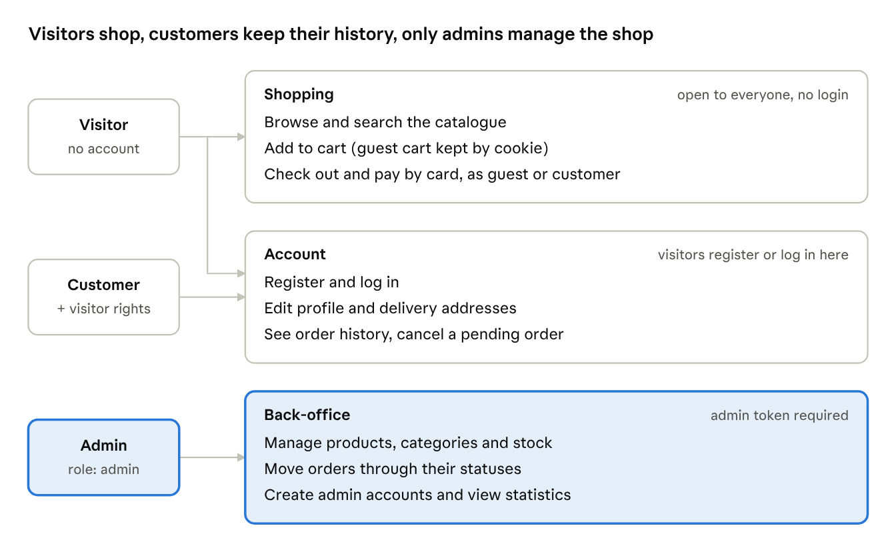
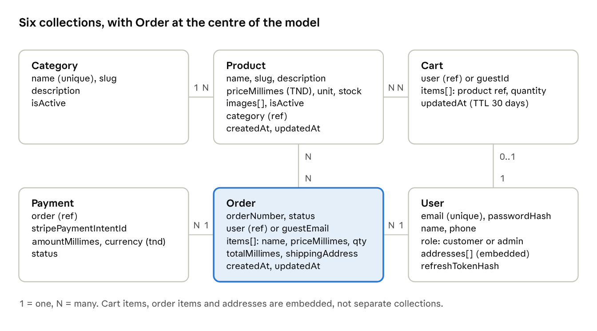

# Pâtisserie Maison – Conception & Plan (Express + Angular)

Nov 15, 2026 · @Faten Ouergli

## Project at a glance

A local, dynamic full-stack shop for a **traditional Tunisian pâtisserie**: an Express REST API (built first) and an Angular client (built second), with admin, customer and visitor roles, a persistent cart and secured online payment in **Tunisian dinars (TND)**, in test mode.

Concept: the shop sells the homemade sweets Tunisian families buy for visits and, above all, for occasions: Ramadan and Aïd, Mouled, weddings and engagements (baklawa, kaak warka, makroudh, ghraiba, bjaouia, mlabes, samsa, zlabia…). Many items are sold by weight or as boxes and trays (plateaux) rather than by the piece, prices are shown in dinars with three decimals (for example 18.500 DT), and delivery addresses use the Tunisian governorates.

I made these decisions so Devin has no ambiguity. Tell me if you want any changed.

| Topic          | Decision                                                                                                                    | Why                                                                                                                                         |
| -------------- | --------------------------------------------------------------------------------------------------------------------------- | ------------------------------------------------------------------------------------------------------------------------------------------- |
| Backend        | Node.js + Express (JavaScript, ES modules)                                                                                  | What the course evaluates                                                                                                                   |
| Database       | MongoDB + Mongoose, local instance                                                                                          | Flexible product/order documents, easy to seed, no cloud needed                                                                             |
| Auth           | JWT access token (15 min) + refresh token in httpOnly cookie, bcrypt hashing                                                | Shows token auth, middleware and roles                                                                                                      |
| Visitors       | A guestId (random UUID) in an httpOnly cookie, linked to a guest cart                                                       | Lets us recognise a visitor on the next visit and merge their cart on login                                                                 |
| Admin accounts | First admin created by a seed script; further admins created only by an existing admin                                      | An admin cannot self-register                                                                                                               |
| Payment        | Stripe in test mode with currency tnd (PaymentIntent + webhook through the Stripe CLI), behind a payment provider interface | Card data never touches our server, works fully local, no real money; a Tunisian gateway can replace Stripe later behind the same interface |
| Frontend       | Angular (standalone components, router, HttpClient, interceptors, guards)                                                   | Phases 9 to 12, after the API is stable                                                                                                           |
| Deployment     | None. Everything runs on localhost                                                                                          | Academic scope                                                                                                                              |

**Assumption to confirm:** "users access using their email" is implemented as register/login with email + password. If your professor expects passwordless email login (magic link), say so and I will adapt the auth section.

## Phase 1 – Conception

Three actors use the system; everything else follows from what each may do.

| Actor    | Identified by                          | Can do                                                                           |
| -------- | -------------------------------------- | -------------------------------------------------------------------------------- |
| Visitor  | guestId cookie, no account             | Browse catalogue, fill a cart, check out as guest, get recognised on return      |
| Customer | Email + password, JWT                  | Everything a visitor does, plus profile, saved addresses, order history, reorder |
| Admin    | Email + password, JWT with role: admin | Manage products, categories, orders, customers and other admins                  |

### User stories (MVP)

**Visitor**

  - V1. I browse products, filter by category or occasion (Ramadan, Aïd, Mouled, wedding) and search by name.

  - V2. I add items to a cart that is still there when I come back.

  - V3. I pay as a guest by giving an email and delivery address.

  - V4. I create an account, and my guest cart and past guest orders join it.

**Customer**

  - C1. I log in, log out and refresh my session securely.

  - C2. I edit my profile and manage delivery addresses.

  - C3. I place an order and pay online by card in TND.

  - C4. I see my orders and their status, and can cancel one while it is still pending.

**Admin**

  - A1. I log in to a protected back-office.

  - A2. I create, edit, hide and delete products and categories, with images, sale unit, price in TND and stock.

  - A3. I see all orders, filter them and move them through the statuses.

  - A4. I create another admin account.

  - A5. I see simple statistics (orders per day, best sellers).

### Business rules

1.  Prices are in Tunisian dinars (TND) and stored as integers in millimes (1 TND = 1,000 millimes, so 18.500 DT is stored as 18500). Prices are multiples of 100 millimes. The server recomputes every total; the client never sends a price.

2.  Each product has a sale unit: piece, box (fixed weight, for example 500 g) or kg. Cart quantities are whole numbers of that unit, and stock is counted in the same unit.

3.  Products can be tagged with occasions (ramadan, aid, mouled, wedding) so the shop can highlight seasonal specialities; a seasonal product is hidden out of season with isActive.

4.  Delivery is within Tunisia only: an address has a governorate (one of the 24) and a 4-digit postal code, and phone numbers are Tunisian (+216 followed by 8 digits).

5.  Stock is checked and decremented when payment is confirmed, never when the item is added to the cart.

6.  Order statuses move only forward: pending → paid → preparing → ready → delivered. cancelled is allowed from pending or paid only.

7.  A guest cart expires after 30 days of inactivity (MongoDB TTL index).

8.  On login, the guest cart merges into the customer cart (same product: quantities add up, capped by stock).

9.  An order stores a snapshot of product name and price at purchase time, so later price changes do not alter history.

10. Only admins can create admins, and an admin cannot delete themselves.

### Non-functional requirements

  - Every input is validated on the server; every error returns the same JSON shape.

  - Passwords hashed, secrets only in .env, no card data stored.

  - Auto-generated API documentation (Swagger) and a Postman collection.

  - Automated tests for auth, cart and order flows.

## Use-case diagram



use cases · 3 actors, 3 groups

The visitor reaches shopping and registration; a customer is a visitor who logged in; only the admin reaches the back-office.

## Phase 2 – Modelling



entity model · 6 collections

One category holds many products. A cart (one per customer, or per guest) lists products, and an order copies product name and price into its own items so history never changes. An order has one or more payment attempts, and belongs to a user or, for guest checkout, to a guest email. Mongoose models: one file per collection, with timestamps: true everywhere.

## Database schema

Database name: patisserie. Money is always an integer in millimes (TND has three decimals: 1 TND = 1,000 millimes). Every collection has createdAt and updatedAt.

| Collection | Fields                                                                                                                                                                               | Indexes and rules                                                                                                                                                             |
| ---------- | ------------------------------------------------------------------------------------------------------------------------------------------------------------------------------------ | ----------------------------------------------------------------------------------------------------------------------------------------------------------------------------- |
| users      | email, passwordHash, firstName, lastName, phone, role (customer or admin), addresses\[\] (label, street, city, governorate, postalCode, isDefault), refreshTokenHash, isActive       | email unique and lowercase; passwordHash never returned by the API (select: false); phone is +216 and 8 digits; governorate from the fixed list of 24; postalCode is 4 digits |
| categories | name, slug, description, isActive                                                                                                                                                    | slug unique                                                                                                                                                                   |
| products   | name, slug, description, priceMillimes, unit (piece, box or kg), weightGrams (for boxes), stock, images\[\], category (ref), occasions\[\], isActive, ingredients\[\], allergens\[\] | slug unique; text index on name and description; priceMillimes integer \>= 0 and a multiple of 100; stock \>= 0; unit and occasions are enums                                 |
| carts      | user (ref, optional), guestId (optional), items\[\] (product ref, quantity)                                                                                                          | One of user or guestId is required; unique sparse index on each; TTL index on updatedAt (30 days) for guest carts                                                             |
| orders     | orderNumber, user (ref, optional), guestEmail, items\[\] (product ref, name, unit, priceMillimes, quantity), totalMillimes, currency (TND), shippingAddress, status, paymentStatus   | orderNumber unique (like PAT-2026-000123); index on user and status; status moves forward only                                                                                |
| payments   | order (ref), stripePaymentIntentId, amountMillimes, currency (tnd), status, lastEvent                                                                                                | stripePaymentIntentId unique; webhook events are idempotent                                                                                                                   |

**Seed data** (script npm run seed): 1 admin, 2 customers with Tunisian addresses (Tunis, Sfax), 4 categories (baklawa & fruits secs, gâteaux secs, douceurs au miel, plateaux de fête), about 20 traditional products with prices in TND and stock (baklawa aux pistaches, kaak warka, makroudh aux dattes, ghraiba homs, bjaouia, mlabes, samsa, yo-yo, zlabia, mkharek, assida zgougou for Mouled…), and 3 sample orders in different statuses.

## REST API contract

Base path /api/v1. Access levels: **public** (visitor, guest cookie), **customer** (valid JWT), **admin** (JWT with role: admin).

| Method              | Path                                        | Access                                 | Purpose                                                                                              |
| ------------------- | ------------------------------------------- | -------------------------------------- | ---------------------------------------------------------------------------------------------------- |
| POST                | /auth/register                              | public                                 | Create a customer account                                                                            |
| POST                | /auth/login                                 | public                                 | Return access token, set refresh cookie, merge guest cart                                            |
| POST                | /auth/refresh                               | public (cookie)                        | Issue a new access token                                                                             |
| POST                | /auth/logout                                | customer                               | Invalidate the refresh token                                                                         |
| GET                 | /users/me                                   | customer                               | Read own profile                                                                                     |
| PATCH               | /users/me                                   | customer                               | Update profile and addresses                                                                         |
| GET                 | /categories                                 | public                                 | List categories                                                                                      |
| GET                 | /products                                   | public                                 | List with ?category=\&occasion=\&search=\&page=\&limit=\&sort=                                       |
| GET                 | /products/:slug                             | public                                 | Product detail                                                                                       |
| POST, PATCH, DELETE | /admin/products and /admin/products/:id     | admin                                  | Create, update, delete products (with image upload)                                                  |
| POST, PATCH, DELETE | /admin/categories and /admin/categories/:id | admin                                  | Manage categories                                                                                    |
| GET                 | /cart                                       | public                                 | Current cart (by user or guestId)                                                                    |
| POST                | /cart/items                                 | public                                 | Add a product                                                                                        |
| PATCH, DELETE       | /cart/items/:productId                      | public                                 | Change quantity, remove                                                                              |
| DELETE              | /cart                                       | public                                 | Empty the cart                                                                                       |
| POST                | /checkout                                   | public                                 | Validate cart and stock, create a pending order and a Stripe PaymentIntent, return its client secret |
| POST                | /payments/webhook                           | Stripe only (signature)                | Confirm payment, decrement stock, mark order paid                                                    |
| GET                 | /orders                                     | customer                               | Own orders                                                                                           |
| GET                 | /orders/:orderNumber                        | customer, or guest with email + number | One order                                                                                            |
| POST                | /orders/:id/cancel                          | customer                               | Cancel while pending                                                                                 |
| GET                 | /admin/orders                               | admin                                  | All orders with filters and pagination                                                               |
| PATCH               | /admin/orders/:id/status                    | admin                                  | Move to the next status                                                                              |
| GET                 | /admin/users                                | admin                                  | List users                                                                                           |
| POST                | /admin/admins                               | admin                                  | Create another admin                                                                                 |
| GET                 | /admin/stats                                | admin                                  | Orders per day, best sellers                                                                         |
| GET                 | /health                                     | public                                 | Liveness check                                                                                       |

**Standard error shape** for every failure: { "status": 422, "code": "VALIDATION\_ERROR", "message": "...", "details": \[...\] }.

## Security design

The strongest rule for payments: **card numbers never reach our server.** Angular collects the card in Stripe's own field, Stripe returns a confirmation, and our server only learns the result through a signed webhook.

| Area              | Measure                                                                                                                          | Express concept it shows        |
| ----------------- | -------------------------------------------------------------------------------------------------------------------------------- | ------------------------------- |
| Passwords         | bcrypt with 12 rounds, minimum length and complexity validated                                                                   | Mongoose pre-save hook          |
| Tokens            | Access JWT 15 min in memory; refresh token 7 days in an httpOnly, SameSite cookie, stored hashed and rotated on use              | Auth service, cookies           |
| Authorization     | authenticate middleware, then authorize('admin') on admin routes; owners can only read their own orders and carts                | Route-level middleware chain    |
| Input validation  | Zod or Joi schema per route; unknown fields stripped; ObjectIds checked                                                          | Validation middleware           |
| NoSQL injection   | express-mongo-sanitize, strict schemas, no raw user objects in queries                                                           | Security middleware             |
| Headers and CORS  | helmet, CORS allowing only the Angular origin with credentials                                                                   | Third-party middleware          |
| Brute force       | express-rate-limit: strict on /auth/\* and /checkout, softer elsewhere                                                           | Rate-limit middleware           |
| Payment integrity | Server recomputes totals from the database; order created before payment; PaymentIntent amount equals order total                | Service layer                   |
| Webhook           | Raw body route with Stripe signature check; idempotent by event id; stock decremented in a transaction-safe update               | express.raw before express.json |
| Guest identity    | guestId is a random UUID in an httpOnly cookie, never trusted as proof of identity for orders (guests need email + order number) | Cookie-parser                   |
| Secrets           | Only in .env, validated at boot, .env.example committed                                                                          | Config module                   |
| Errors            | One central error handler; no stack traces to the client outside development                                                     | Error-handling middleware       |
| Logging           | morgan for requests; a small logger for auth failures and payment events                                                         | Logging middleware              |

To test payments locally: Stripe test keys, PaymentIntents created with currency: 'tnd' and the amount in millimes, test card 4242 4242 4242 4242, and the Stripe CLI forwarding webhooks to localhost. Stripe does not onboard Tunisian businesses, so a real launch would use a local gateway (for example Konnect or ClicToPay). The mock payment provider with the same interface (createPayment, confirmPayment) keeps that switch easy and is also the fallback if Stripe feels too heavy for the course; the flow stays identical.

## Backend architecture and folder structure

Layered: **route → controller → service → model**. Controllers only read the request and send the response; services hold the business rules; models talk to MongoDB. This separation is what a professor looks for.

```text
patisserie-api/
├── src/
│   ├── app.js                 # builds the Express app (middleware order matters)
│   ├── server.js              # connects to MongoDB, starts listening
│   ├── config/                # env.js (validated), db.js, stripe.js
│   ├── models/                # User, Category, Product, Cart, Order, Payment
│   ├── routes/                # auth, users, products, categories, cart, checkout, orders, admin
│   ├── controllers/           # one per route file
│   ├── services/              # auth, cart, order, payment, stats
│   ├── middlewares/           # authenticate, authorize, guestSession, validate,
│   │                          # rateLimiter, errorHandler, notFound, upload
│   ├── validators/            # Zod/Joi schemas per route
│   ├── utils/                 # AppError, asyncHandler, token helpers, orderNumber
│   └── docs/                  # swagger.yaml
├── scripts/seed.js
├── tests/                     # Jest + Supertest
├── uploads/                   # product images (local, git-ignored)
├── .env.example
└── package.json
```

Express concepts deliberately left visible for the evaluation:

  - Router and express.Router() per resource, mounted under /api/v1.

  - Application-level, router-level, third-party and error-handling middleware, with a comment on why each is ordered where it is.

  - Custom AppError class and an asyncHandler wrapper so async errors reach the error middleware.

  - req.params, req.query, req.body, req.cookies, and a custom req.guestId / req.user.

  - File upload with multer, static serving with express.static.

  - Environment config, CORS, pagination and filtering helpers.

  - Automated tests with Jest and Supertest; Swagger UI at /api/docs.

## Phase plan

Phases 1 and 2 are this document. Devin starts at phase 3 and should finish each phase, with passing tests, before the next one. Ask it to open one branch and one commit series per phase so you can review.

| \# | Phase                        | Output                                                                                                   | Done when                                                          |
| -- | ---------------------------- | -------------------------------------------------------------------------------------------------------- | ------------------------------------------------------------------ |
| 1  | Conception                   | Actors, stories, rules                                                                                   | This document, approved by you                                     |
| 2  | Modelling                    | Entity diagram, schema, API contract                                                                     | This document, approved by you                                     |
| 3  | Setup                        | Project skeleton, config, MongoDB connection, models, seed script, error handler, /health                | npm run dev starts, npm run seed fills the database                |
| 4  | Auth and users               | Register, login, refresh, logout, authenticate, authorize, admin seed and admin creation                 | Auth tests pass; admin routes return 403 for customers             |
| 5  | Catalogue and back-office    | Categories and products CRUD, search, filter, pagination, image upload                                   | A customer cannot write; admin can                                 |
| 6  | Cart and guests              | guestSession middleware, cart endpoints, guest-to-customer merge, TTL                                    | A guest cart survives a restart of the browser and merges on login |
| 7  | Checkout, payment and orders | Checkout service, Stripe PaymentIntent, webhook, stock decrement, order statuses, admin order management | Test card flow ends with a paid order and reduced stock            |
| 8  | Hardening and docs           | Rate limiting, sanitising, Swagger, Postman collection, README, full test run                            | npm test green; README lets a stranger run the project             |
| 9  | Angular foundation           | Workspace, routing, layouts, auth service, HTTP interceptors (token, refresh, errors), route guards      | Login works and admin pages are guarded                            |
| 10 | Angular shop                 | Catalogue, product page, cart, checkout with Stripe card field, order history                            | A visitor can order as guest; a customer sees history              |
| 11 | Angular back-office          | Admin dashboard, product and order management, stats                                                     | Admin completes the full order lifecycle                           |
| 12 | Final polish                 | Responsive layout, loading and error states, demo script, report                                         | Ready for the presentation                                         |

You handle phases 1 and 2 (done here) and the review gates; Devin implements phases 3 to 12 backend first, then Angular.

## Brief for Devin.ai

Devin cannot open this document, so export it (Markdown or PDF) and commit it to the repo as docs/SPEC.md, then paste the brief below as the first task.

```markdown
# Task: implement the Pâtisserie Maison backend (phases 3 to 8)

Context: academic project for a traditional Tunisian pâtisserie, local only (no deployment). Stack: Node.js, Express, MongoDB with Mongoose, JavaScript ES modules. An Angular client comes later, so the API must be clean and documented.

The full specification is in `docs/SPEC.md`: actors and business rules, entity model, database schema, REST API contract, security design, folder structure, phase plan. Treat it as the source of truth. If something is ambiguous or contradictory, stop and ask instead of guessing.

## Rules
1. Follow the folder structure and the layering route -> controller -> service -> model exactly.
2. Work phase by phase (3, 4, 5, 6, 7, 8). One branch per phase, small commits, and tests passing before moving on. Summarise each phase in `docs/PROGRESS.md`.
3. Money is in Tunisian dinars (TND), stored as integer millimes (1 TND = 1000 millimes). The server recomputes all totals; never trust prices from the client.
4. Never store card data. Payments go through Stripe in test mode (PaymentIntent with currency `tnd` + signed webhook). Provide a mock payment provider behind the same interface as a fallback.
5. Implement every security measure listed in the Security design section.
6. Add short comments explaining why each middleware is placed where it is (this is an evaluated course project).
7. Every endpoint: validated input, the standard error shape, Swagger documentation, and at least one Jest + Supertest test for the happy path and one for the main failure.
8. Provide `.env.example`, `npm run dev`, `npm run seed`, `npm test`, and a README that lets a newcomer run everything locally.

## Definition of done for the backend
- All endpoints in the API contract work against a local MongoDB.
- A guest can fill a cart, pay in TND with the Stripe test card and receive a `paid` order.
- Customer and admin permissions are enforced and tested.
- `npm test` passes and Swagger is served at `/api/docs`.

Start with phase 3 and report back when it is done.
```

For the Angular part, give Devin a second brief later (phases 9 to 12) once the API is stable and its Swagger file is in the repo. Angular shows prices in TND with three decimals (for example 18.500 DT), converted from millimes in one shared pipe.
